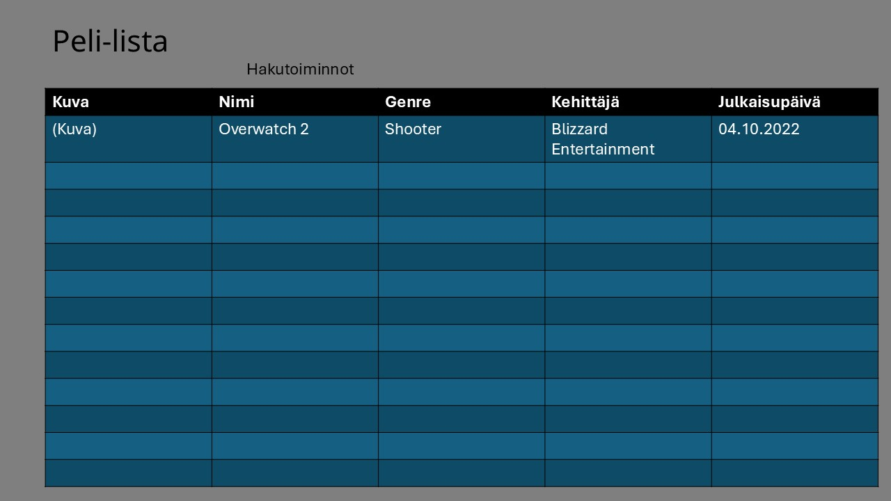
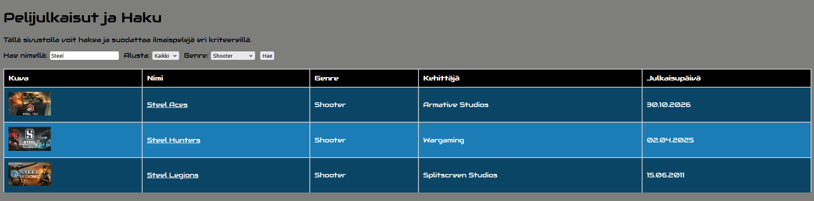

# Projektin nimi

**Tekijä(t):** Juha Korhonen / Jon Mattila

## Projektisuunnitelma

### Projektin idea

Sovellus näyttää 50 viimeisintä pelijulkaisua avatessa ja käyttäjä voi hakea pelejä käyttämällä hakutoimintoja.

### Suunnitellut toiminnot

Listaa vähintään kolme sovellukseesi suunniteltua toimintoa:

- Näyttää sivun auetessa 50 viimeisintä pelijulkaisua.
- Käyttäjä voi hakea pelejä hakutoiminnolla.
- Käyttäjä voi siirtyä pelin sivulle linkistä.

### Rautalankamalli / luonnos

## Verkkolinkit

- **Julkaistu sovellus:** https://yuhius.github.io/Projekti_2a_AJAX_sovellus/index.html
- **GitHub-repositorio:** https://github.com/Yuhius/Projekti_2a_AJAX_sovellus
- **Projektin videoesittely:** https://video.laurea.fi/media/Projekti2a+Videodemo%2C+Juha+Korhonen+Jon+Mattila/0_yq457j4w

## Tietoja sovelluksesta

**Pelijulkaisut** on verkkosovellus, joka näyttää pelit freetogame-sivustolta hakemalla rajapintoja.

Kuvaile lyhyesti sovelluksen tarkoitus ja tärkeimmät toiminnot.

## Teknologiat

Kuvaile, mitä teknologioita käytit ja mikä niiden rooli oli projektissasi.

- HTML – sivun rakenne
- CSS – ulkoasu ja asettelu
- JavaScript – toiminnallisuus, DOM-skriptaus ja lomakkeiden validointi

## Sovelluksen käyttö

Kirjoita lyhyet käyttöohjeet sovellukselle.

1. Avaa julkaistu sovellus yllä olevasta linkistä.
2. Täytä lomakkeen kentät ja valitse alasvetovalikoista.
3. Paina Hae-nappia.

## Sovelluksen käynnistäminen paikallisesti

1. Kloonaa tai lataa tämä repositorio omalle koneellesi.
2. Avaa projektikansio.
3. Avaa `index.html` selaimessa.

## Kuvakaappaukset

Lisää tähän vähintään yksi kuvakaappaus toimivasta sovelluksestasi.

Esimerkki kuvan lisäämisestä:

## Tunnetut virheet / puutteet

**Ei tunnettuja virheitä.**

## Työn jakautuminen

Ohjelman toteutuksesta vastasivat Juha Korhonen ja Jon Mattila. Työskentely aloitettiin suunnittelemalla ohjelman rautalankamalli PowerPointilla. Ohjelman koodaus toteutettiin Juhan tietokoneella, ja projektin Git-repositorio sijaitsee Juhan hallinnoimassa ympäristössä.

Molemmat osapuolet osallistuivat aktiivisesti ohjelman kehittämiseen, ja työtehtävät jakautuivat tasaisesti tekijöiden kesken. Yhteistyö sujui hyvin ja ongelmitta koko projektin ajan. Ohjelmaa kehitettiin molempien vapaa-ajalla.

## Oma arvio ja oppimisen reflektointi

Pohdi työtäsi ja oppimisprosessiasi.

- Missä onnistuin? Ohjelma toimii.
- Mikä oli haastavaa? AJAX-koodi näyttää todella monimutkaiselta.
- Mitä parantaisin, jos aikaa olisi enemmän? En mitään. It's perfect!
- Mitä opin HTML:stä, CSS:stä, JavaScriptistä ja DOM-skriptauksesta? Ei mitään mitä emme ennestään tienneet.
- Mikä jäi epäselväksi tai mistä haluaisin oppia lisää? Kaikki.
- Oma arvio projektista: **10/10 pistettä**

## Lähteet ja kiitokset

- Lopullinen työ on luotu opiskelijoiden ideasta.
- Geminiä on ohjattu opiskelijoiden haluamaan suuntaan.
- Käytetty hyväksi aikaisempia workshoppeja ja opiskelumateriaalia.
- Font-familyt selvitettiin Google Font Familysta.
- Käytetty Geminiä kommenttien jäsentelyyn.
- API: www.freetogame.com/api-doc 

  ## Lisenssi

Tämä projekti on lisensoitu MIT-lisenssillä.

Lisätietoa lisenssin lisäämisestä GitHub-projektiin:
https://docs.github.com/en/communities/setting-up-your-project-for-healthy-contributions/adding-a-license-to-a-repository